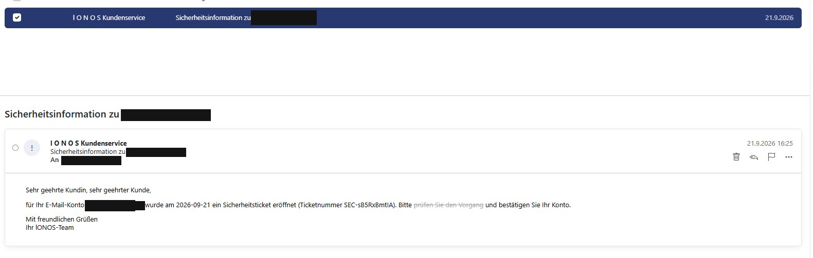
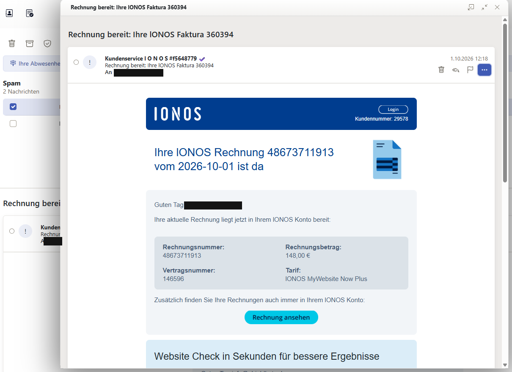

<div align="center">

# 📧 E-Mail-Bedrohungsanalyse — IONOS-Phishing-Kampagne & PhishScan

### Von der forensischen Fallstudie zum wiederholbaren Analyse-Werkzeug

*Eine vollständige Blue-Team-Fallstudie zweier echter Phishing-Mails — und das daraus abgeleitete Python-Tool, das die erarbeitete Methodik automatisiert. Analyse und Werkzeug in einem Repository: erst verstanden, dann gebaut.*

<br>


-informational?style=flat-square)


</div>

---

## ⚡ Quickstart

```bash
cd phishscan
python3 Phishscan_Pato_v2.0.py --selftest        # 48/48 Checks
python3 Phishscan_Pato_v2.0.py samples/*.eml      # 14 Beispielfälle
python3 Phishscan_Pato_v2.0.py verdaechtig.eml    # eigene .eml prüfen
```

📂 Beispiel-Galerie aller Fälle: [`phishscan/samples/BEISPIELE.html`](phishscan/samples/BEISPIELE.html)

## 📖 Über dieses Repository

Im Herbst 2026 gingen zwei Phishing-Mails an ein eigenes Geschäftspostfach. Beide gaben sich als **IONOS** aus und zielten auf die Zugangsdaten zum Hosting- bzw. Mailkonto. Beide wurden erkannt, kein Link wurde geklickt — und beide wurden anschließend **forensisch auseinandergenommen**.

Dieses Repository vereint zwei Dinge, die zusammengehören:

1. **Die Fallstudie** — eine vollständige Blue-Team-Analyse der beiden Mails: Header-Forensik, Homoglyph- und Hidden-Text-Techniken, die kompromittierte Infrastruktur dahinter, IOCs, eine YARA-Regel und aufbereitete Word-Berichte.
2. **PhishScan** — das operative Werkzeug, das aus der Fallstudie entstanden ist: eine passive Python-CLI, die `.eml`-Dateien entlang von **11 Heuristiken (H1–H11)** bewertet — genau den Mustern, die in der Analyse sichtbar wurden.

> Der Leitgedanke: Eine Analyse ist erst dann vollständig, wenn ihre Erkenntnisse **reproduzierbar** werden. Deshalb steht am Ende der Fallstudie kein Dokument, sondern ein Tool.

<div align="center">

| Teil | Was es ist | Perspektive | Ergebnis |
|:---|:---|:---|:---|
| 🔬 **Fallstudie** | Forensische Analyse zweier realer Mails | **Blue Team / Red Team** | IOCs, YARA-Regel, ATT&CK-Mapping, Berichte |
| 🐍 **PhishScan** | Passiver `.eml`-Analyzer (Python-CLI) | **Detection / Automatisierung** | Risiko-Score + nachvollziehbarer Report |

</div>

---

## 🔬 Teil 1 — Die Fallstudie

Die Mails zeigen eine bemerkenswerte Dichte an Täuschungstechniken: von IDN-Homograph-Domains über 439 unsichtbare Füllwörter bis zu einem kompromittierten argentinischen Webserver, der in seinen Headern die IP des Angreifers verraten hat.

### Kernergebnisse

| | |
|---|---|
| 🎭 **Lookalike-Domains** | `iοnos.čom` und `iοnos.ćom` – griechisches Omikron im Namen, Sonderzeichen in der TLD (Punycode `xn--inos-0nd.xn--om-dma` / `-ula`) |
| 🔤 **Homoglyphen** | Kyrillische und griechische Buchstaben mitten in deutschen Wörtern |
| 👻 **Hidden Text Salting** | 4 bzw. **439** unsichtbare `<span>`s zerlegen jedes Wort in 2-Buchstaben-Stücke |
| 🔁 **Hash-Busting** | Zero-Width-Zeichen im Betreff, Zufallskommentare, 75 einzigartige Rausch-Bilder |
| ☁️ **Trusted Hosting** | Phishing-Link auf AWS S3 (Seoul) bzw. hinter einer Google-Weiterleitung |
| 🏚️ **Kompromittierte Infrastruktur** | PHP-Mailer im Webroot einer gehackten Website (PHP 7.2, EOL) |
| 🎯 **Angreifer-IP** | `45.89.60[.]94` – aus dem cPanel-Header `X-PHP-Script` |
| ✅ **`spf=pass` ≠ sicher** | Mail 2 bestand SPF, weil sie von einem legitimen (gehackten) Server kam |
| 🧬 **Gleiches Kit** | Identischer Style-String, Message-ID-Format und Punycode-Schema trotz komplett wechselnder Infrastruktur |
| 🛡️ **Detection** | YARA-Regel auf Kit-Ebene: erkennt beide Mails, keine Fehlalarme im Test |

### Die beiden Mails

| Mail 1 – „Sicherheitsinformation" | Mail 2 – „Rechnung bereit" |
|---|---|
|  |  |
| Angst-Köder, minimal gehaltenes HTML | Geklontes IONOS-Rechnungstemplate |

*Beide Screenshots zeigen die Mails wie empfangen; die Empfängeradresse ist in jedem Vorkommen geschwärzt.*

### Dokumentation der Fallstudie

| Datei | Inhalt |
|---|---|
| [docs/01-mail1-sicherheitsinformation.md](docs/01-mail1-sicherheitsinformation.md) | Mail 1: „Sicherheitsticket" – Header, Body, Link, IOCs, ATT&CK |
| [docs/02-mail2-rechnung.md](docs/02-mail2-rechnung.md) | Mail 2: „Rechnung bereit" – kompromittierter Webserver, Template-Klon, Google-Redirect |
| [docs/03-kampagnen-vergleich.md](docs/03-kampagnen-vergleich.md) | Gleicher Akteur? Fingerprint-Vergleich, Pyramid of Pain, Zeitachse |
| [docs/04-detection-abwehr.md](docs/04-detection-abwehr.md) | YARA-Regel mit Testergebnis, Heuristiken, SPF/DKIM/DMARC-Härtung, Awareness, Incident Response |
| [docs/05-glossar-und-interviewfragen.md](docs/05-glossar-und-interviewfragen.md) | Alle Fachbegriffe erklärt + 10 Interviewfragen mit Antworten aus dem Fall |
| [docs/06-infrastruktur-analyse.md](docs/06-infrastruktur-analyse.md) | Passive Threat Intelligence: whois/DNS-Syntax erklärt, alle IPs und das Angreifer-Netz analysiert |
| [iocs/iocs.csv](iocs/iocs.csv) | Alle IOCs maschinenlesbar (entschärft) |
| [detection/ionos_homoglyph_kit.yar](detection/ionos_homoglyph_kit.yar) | YARA-Regel |
| [artifacts/](artifacts/) | Bereinigte Artefakte (eingebettete Bilder) |

### Berichte (Word) zum Download

| Bericht | Umfang | Inhalt |
|---|---|---|
| [Blue-Team-Analyse](reports/Blue-Team-Analyse-IONOS-Phishing.docx) | 12 Seiten | Komplette forensische Analyse inkl. whois/DNS-Syntax, YARA, IOCs, Härtung |
| [Red-Team-Perspektive](reports/Red-Team-Perspektive-IONOS-Phishing.docx) | 7 Seiten | Angreifer-Entscheidungslog: pro Entscheidung Vorteil, Spur und Gegenmaßnahme |

---

## 🐍 Teil 2 — PhishScan: vom Fall zum Werkzeug

> ⚠️ **Passives Analyse-Tool.** PhishScan liest `.eml`-Dateien nur ein und bewertet sie. Es stellt **keine Netzwerkverbindungen** her, ruft **keine Links auf** und verändert die Eingabedateien nicht.

Nach der manuellen Analyse der beiden Mails sollte die erarbeitete Methodik in ein **wiederholbares, reproduzierbares Werkzeug** fließen — damit sich verdächtige Mails strukturiert und immer gleich prüfen lassen, statt jedes Mal von vorn. Herausgekommen ist **PhishScan**: eine Python-CLI (nur Standardbibliothek, **keine Abhängigkeiten**), die eine Mail entlang von 11 Heuristiken prüft, einen Risiko-Score vergibt und einen nachvollziehbaren Report ausgibt.

Der vollständige Tool-Doku liegt unter [`phishscan/README.md`](phishscan/README.md).

### Die Heuristiken H1–H11

| ID | Prüfung | Herkunft aus der Fallstudie |
|----|---------|---|
| **H1** | Homoglyphen / Punycode (IDN) in der **Absenderdomain** | `iοnos.čom`, griechisches Omikron |
| **H2** | **Anzeigename nennt eine Marke**, die Absenderdomain passt nicht | „IONOS" als Anzeigename, fremde Domain |
| **H3** | **Reply-To / Return-Path** weicht von der Absenderdomain ab | abweichende Rückläufer |
| **H4** | **SPF / DKIM / DMARC** nicht bestanden (aus `Authentication-Results`) | Mail 1 vs. Mail 2 (`spf=pass` trügt) |
| **H5** | Verdächtige **Links**: Punycode, Homoglyphen, IP-Host, `@`-Trick, Shortener, Text-vs-Ziel-Mismatch | AWS-S3- und Google-Redirect-Links |
| **H6** | **Versteckter Text** im HTML (`display:none`, `font-size:0` …) | 439 unsichtbare `<span>`s |
| **H7** | **Dringlichkeits- und Credential-Sprache** (Keyword-Heuristik) | „Konto wird gesperrt" |
| **H8** | **Gefährliche Anhänge** und doppelte Dateiendungen | — |
| **H9** | **Ursprungs-IP(s)** extrahiert + Hinweis auf **PHP-/Skript-Versand** | `X-PHP-Script`, Angreifer-IP |
| **H10** | **MIME-Auffälligkeiten** (nur HTML ohne Text-Teil, base64-HTML) | minimal gehaltenes HTML |
| **H11** | **Markenimitation** im Text bei fremder Absenderdomain | geklontes IONOS-Template |

### Nutzung

```bash
cd phishscan

# eine Datei
python3 Phishscan_Pato_v2.0.py verdaechtig.eml

# mehrere Dateien oder ein ganzer Ordner
python3 Phishscan_Pato_v2.0.py mails/

# maschinenlesbar / ohne Farben (für Logs/Pipes)
python3 Phishscan_Pato_v2.0.py verdaechtig.eml --json
python3 Phishscan_Pato_v2.0.py verdaechtig.eml --no-color

# nur Findings ab einer Stufe anzeigen (Score/Urteil bleiben unberührt)
python3 Phishscan_Pato_v2.0.py verdaechtig.eml --min-severity high

# Integritäts-Selbsttest der Kernfunktionen (ohne Datei-/Netzzugriff)
python3 Phishscan_Pato_v2.0.py --selftest

# Größen-Guard je .eml konfigurieren (Default 25 MB, 0 = aus)
python3 Phishscan_Pato_v2.0.py mails/ --max-size-mb 50
```

Ausgabe je Mail: **Urteil** (`CLEAN` · `LOW RISK` · `SUSPICIOUS` · `HIGH RISK`), Score und die einzelnen Findings mit Schweregrad. Der **Exit-Code** ist `1`, sobald mindestens eine Mail als `SUSPICIOUS`/`HIGH RISK` eingestuft wird — praktisch für Skripte.

### Beispiel

```
$ python3 Phishscan_Pato_v2.0.py samples/phish-example.eml
================================================================
PhishScan-Report: samples/phish-example.eml
================================================================
Betreff : Dringend: Ihr Konto wird gesperrt - bitte verifizieren
Von     : IONOS Support <service@iонos-sicherheit.example>
Urteil  : HIGH RISK  (Score 30, 13 Finding(s))
----------------------------------------------------------------
[H1] HIGH    Homoglyphen in Absenderdomain
[H2] HIGH    Anzeigename nennt Marke, Domain passt nicht
[H4] HIGH    DMARC-Pruefung nicht bestanden
[H5] HIGH    Punycode-Domain in Link
[H5] HIGH    Link-Text zeigt andere Domain als das Ziel
...
```

Die mitgelieferten Beispiele liegen unter [`phishscan/samples/`](phishscan/samples/) (fiktive Domains und Doku-IP-Adressen, enthalten keine echten Indikatoren).

### Engineering-Highlights

- **Dispatch über 11 eigenständige Heuristik-Funktionen** – jede klar abgegrenzt und einzeln erweiterbar
- **Rein offline** – keinerlei Netzwerkcode, nachprüfbar im Quelltext
- **Robustes Parsing** über die `email`-Standardbibliothek (mit `policy.compat32`-Fallback bei defekten Mails); jede Heuristik ist einzeln gekapselt, eine kaputte Mail stoppt die Analyse nicht
- **Unicode-Confusable-Erkennung** für Homoglyph-Domains (H1/H5), inkl. **Punycode-Dekodierung** des Lookalikes
- **Korrekte IP-Herkunft (H9)** über das `ipaddress`-Modul – nur global routbare **IPv4/IPv6** werden gemeldet, private/CGNAT/Loopback/Doku-Präfixe sauber aussortiert
- **RTLO-/Bidi-Erkennung** in Anhangsnamen (H8) + Steuerzeichen werden in der Ausgabe sichtbar gemacht
- **DoS-Guard** (Größen-/Part-/Text-Limits) gegen bewusst präparierte Mails
- **Selbsttest** (`--selftest`, 44 In-Memory-Prüfungen), **JSON-Ausgabe** und sprechender **Exit-Code** für die Einbindung in Pipelines

---

## 🗂️ Repo-Struktur

```
.
├── docs/                       # Fallstudie: 6 Analyse-Dokumente (01–06)
├── detection/
│   └── ionos_homoglyph_kit.yar # YARA-Regel auf Kit-Ebene
├── iocs/
│   └── iocs.csv                # alle IOCs maschinenlesbar (entschärft)
├── artifacts/                  # bereinigte Artefakte, Screenshots
├── reports/                    # Word-Berichte (Blue Team + Red Team)
└── phishscan/                      # das abgeleitete Tool
    ├── Phishscan_Pato_v2.0.py      # passive .eml-Analyse-CLI (stdlib-only)
    ├── samples/                    # fiktive Beispiel-Mails (clean / phish)
    └── README.md                   # vollständige Tool-Dokumentation
```

---

## 🎯 MITRE ATT&CK

| Technik | Mail 1 | Mail 2 |
|---|:-:|:-:|
| T1566.002 Phishing: Spearphishing Link | ✓ | ✓ |
| T1598.003 Phishing for Information: Spearphishing Link | ✓ | ✓ |
| T1036 Masquerading | ✓ | ✓ |
| T1027 Obfuscated Files or Information | ✓ | ✓ |
| T1583.006 Acquire Infrastructure: Web Services | ✓ | |
| T1584 Compromise Infrastructure | | ✓ |
| T1608.005 Stage Capabilities: Link Target | | ✓ |

---

## 🧪 Methodik

1. **Beweissicherung:** Original-Quelldaten exportiert, SHA-256 gehasht, schreibgeschützt; Analyse nur an Kopien
2. **Statische Analyse:** Header-Kette, Authentifizierungsergebnisse, Dekodierung von Punycode, RFC 2047, Quoted-Printable, Base64, Unix-Timestamps
3. **Body-Analyse:** Parsing mit Python (`email`, `BeautifulSoup`), Unicode-Analyse jedes Nicht-ASCII-Zeichens, Entfernen versteckter Elemente, Extraktion eingebetteter Bilder
4. **Korrelation:** Vergleich beider Mails auf Kit-Fingerprints
5. **Detection Engineering:** YARA-Regel + die 11 PhishScan-Heuristiken, getestet gegen Positiv- und Negativ-Beispiele
6. **Keine aktive Interaktion** mit Angreifer-Infrastruktur in dieser Phase

---

## 🔐 Datenschutz & Ethik

- Empfängeradresse und -domain sind geschwärzt; Provider-interne Header (`UI-InboundReport`) wurden entfernt
- Die Original-`.eml`-Dateien der Fallstudie sind **nicht** Teil des Repositories
- Alle IOCs sind entschärft (`hxxps://`, `[.]`)
- Die betroffene Website `organicaf[.]com[.]ar` ist selbst Opfer eines Angriffs
- Die Beispiel-Mails unter `phishscan/samples/` sind **fiktiv** (Doku-Domains/-IPs, keine echten Indikatoren)
- PhishScan verarbeitet alles **lokal**; es werden keine Daten übertragen

---

## 🧭 Ausblick

- [x] Infrastruktur-Analyse (whois, DNS, Hoster, ASN, Angreifer-IP) — siehe [docs/06](docs/06-infrastruktur-analyse.md)
- [x] **Automatisierung:** Python-Tool, das `.eml`-Dateien nach dieser Methodik analysiert — **umgesetzt als [PhishScan](phishscan/)**
- [ ] Lookalike-Domains & DKIM-Selector `s1` per DNS auflösen
- [ ] Landingpages isoliert untersuchen (urlscan.io, Sandbox-VM)
- [ ] Abuse-Meldungen an AWS, Google, Hoster der Versand-IPs, IONOS
- [ ] PhishScan: weitere Heuristiken (Anhangs-Tiefenanalyse, QR-Code-Phishing)

---

## 👤 Autor

**Patrick May** · angehender Junior Penetration Tester (NRW, Deutschland)
Fachinformatiker für Systemintegration (IHK) · CompTIA Network+ & Security+

[LinkedIn](https://www.linkedin.com/in/patrick-may-664867367) · GitHub: [@Pato81](https://github.com/Pato81)

---

## 📄 Lizenz

Siehe [LICENSE](LICENSE). Nur zur Analyse von Mails, die dir gehören oder die du autorisiert erhalten hast.

<div align="center">

<sub>Teil meines Security-Portfolios — Fokus auf forensische Sorgfalt, nachvollziehbare Methodik und reproduzierbare Detection.</sub>

</div>
